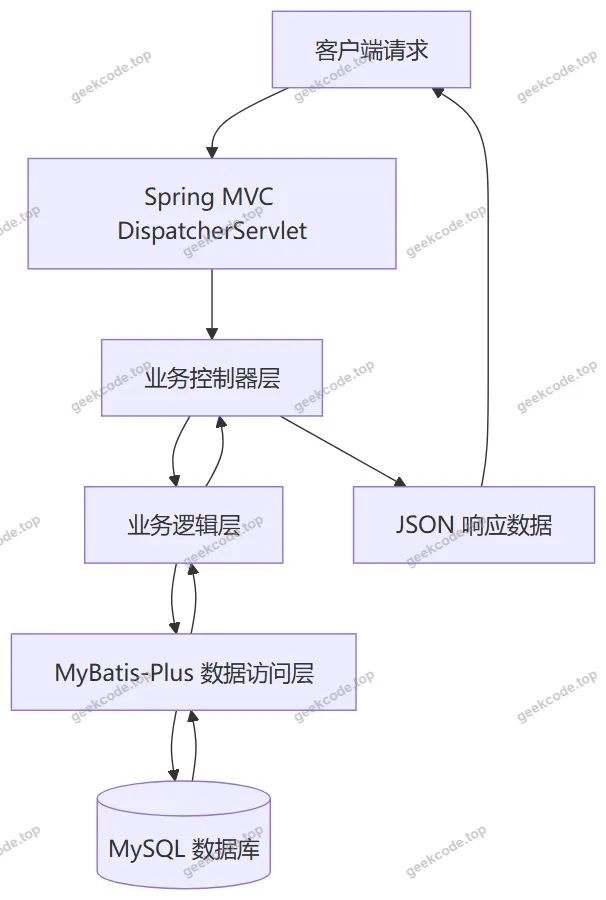
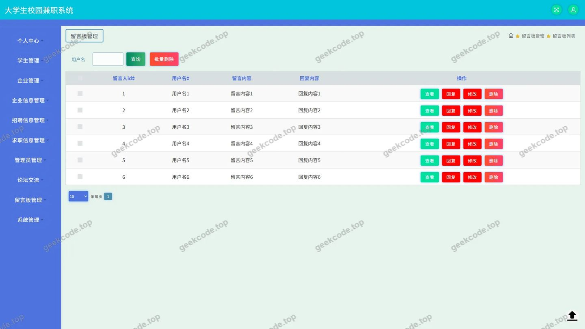
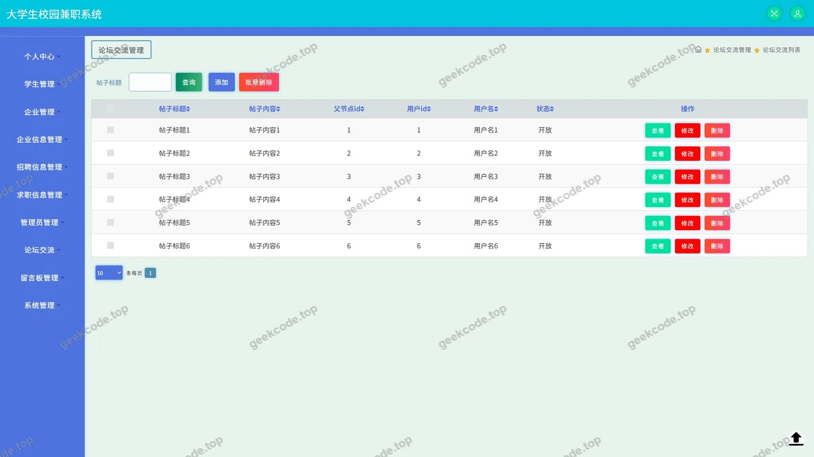
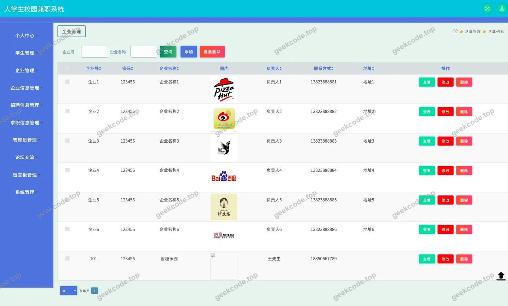
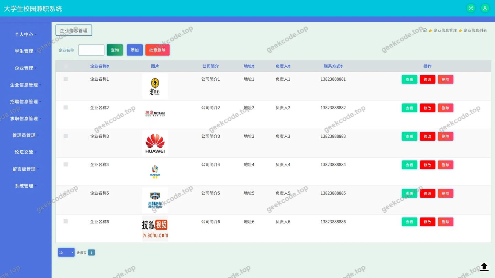
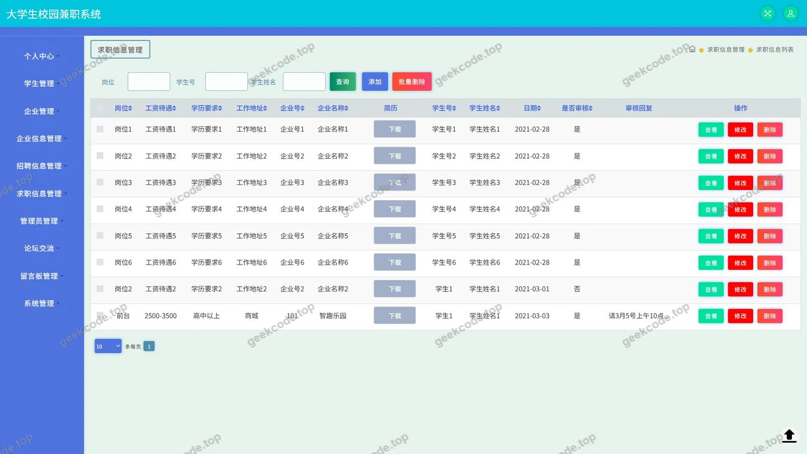
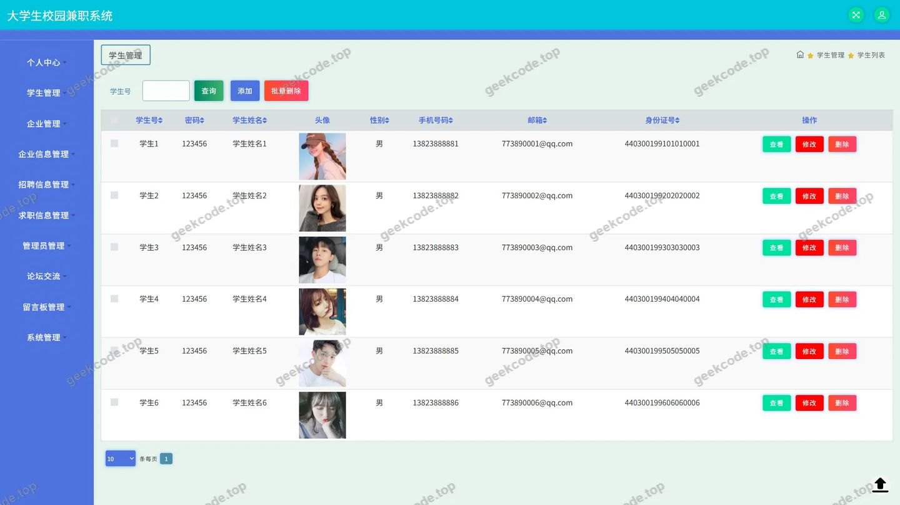
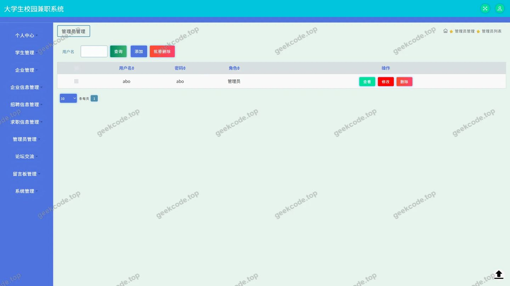
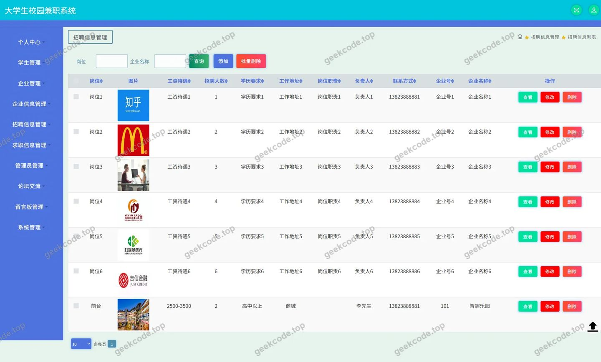

# 大学生校园兼职系统

> 🎓 **计算机毕业设计 · 大学生校园兼职系统**
>
> 本仓库只放**项目介绍 + 运行截图**（截图是站点带水印的原图，存在仓库 `images/` 里）。
>
> 👉 **完整可运行源码 / 数据库脚本 / 部署文档：[点我获取](https://geekcode.top/archives/%E5%A4%A7%E5%AD%A6%E7%94%9F%E6%A0%A1%E5%9B%AD%E5%85%BC%E8%81%8C%E7%B3%BB%E7%BB%9F?utm_source=github)**
>
> 💬 咨询微信：**ir9372**　|　🌐 更多项目：[极客代码 geekcode.top](https://geekcode.top/?utm_source=github)
>
> 📌 项目详情页：<https://geekcode.top/archives/%E5%A4%A7%E5%AD%A6%E7%94%9F%E6%A0%A1%E5%9B%AD%E5%85%BC%E8%81%8C%E7%B3%BB%E7%BB%9F?utm_source=github>

<table><td width="230" align="center"> <b>扫码加微信 ir9372</b></td><td valign="middle">📦 源码 = 项目介绍 + 全部运行截图 + 数据库 + 部署文档 👉 点上方任意截图，直接跳到 <b>极客代码 geekcode.top</b> 详情页</td></table>

---

<h1>大学生校园兼职系统</h1>
<h2>项目概述</h2>

大学生校园兼职系统旨在构建一个高效、便捷的校园求职与招聘对接平台，解决学生兼职信息不对称及企业招聘渠道单一的问题。系统核心功能涵盖企业信息管理、招聘信息发布、论坛交流互动及留言反馈机制，支持用户个人中心查看“我的发布”记录。技术架构采用纯后端 API 服务模式（Pure-API），基于 Spring Boot 框架结合 MyBatis-Plus 进行数据持久层操作，使用 Druid 连接池优化数据库访问性能。适用人群主要为寻求兼职机会的大学生群体以及需要招募校园劳动力的企事业单位。通过标准化的接口设计，系统实现了业务逻辑与前端展示的解耦，具备高扩展性与易维护性，为校园人力资源配置提供了数字化解决方案。

<h2>技术架构</h2>

本项目采用前后端分离的纯 API 架构模式，后端服务负责处理所有业务逻辑、数据验证及持久化操作，不直接渲染 HTML 页面，而是通过 JSON 格式返回数据供客户端调用。

<strong>核心技术选型：</strong>

<ol>
<li><strong>基础框架</strong>：基于 Spring Boot 体系，依赖 <code>spring-core</code>, <code>spring-context</code>, <code>spring-web</code>, <code>spring-webmvc</code> 等模块构建 Web 应用容器，利用 <code>spring-aop</code> 实现切面编程以增强事务管理和日志记录能力。</li>
<li><strong>ORM 框架</strong>：选用 MyBatis-Plus 作为持久层框架，简化 CRUD 操作，提供强大的条件构造器，提升开发效率并减少 SQL 注入风险。</li>
<li><strong>数据库连接</strong>：集成 Druid 连接池，具备监控功能，能有效管理数据库连接资源，提高并发处理能力。</li>
<li><strong>测试支撑</strong>：引入 JUnit 单元测试框架，确保核心业务逻辑的正确性。</li>
</ol>

<strong>控制器层设计：</strong>
系统定义了多个 RESTful 风格的 Controller，包括 <code>UserController</code>（用户认证）、<code>QiyeController</code>/<code>QiyexinxiController</code>（企业管理）、<code>ZhaopinxinxiController</code>/<code>QiuzhixinxiController</code>（招聘信息与求职信息）、<code>ForumController</code>（论坛）及 <code>MessagesController</code>（留言反馈）。<code>CommonController</code> 和 <code>ConfigController</code> 负责通用配置与文件上传处理（<code>FileController</code>）。

<strong>数据交互流程：</strong>

<h2>功能模块</h2>

根据源码中的 Controller 定义及截图所示的功能页面，系统主要划分为以下核心业务模块：

<h3>1. 用户与认证模块</h3>
<ul>
<li><strong>登录注册</strong>：提供用户身份验证接口，支持账号密码登录，对应 <code>UserController</code> 及“页面-登录”。</li>
<li><strong>个人信息管理</strong>：包含普通用户与学生角色的信息管理，对应 <code>XueshengController</code> 及“页面-学生”，支持查看和维护个人资料。</li>
</ul>
<h3>2. 企业招聘模块</h3>
<ul>
<li><strong>企业信息管理</strong>：允许录入和维护企业基本资料，对应 <code>QiyeController</code>、<code>QiyexinxiController</code> 及“页面-企业”、“页面-企业信息”。</li>
<li><strong>招聘信息发布</strong>：企业可发布具体的兼职岗位详情，对应 <code>ZhaopinxinxiController</code> 及“页面-招聘信息”。</li>
<li><strong>求职信息管理</strong>：学生可发布个人求职意向或申请记录，对应 <code>QiuzhixinxiController</code> 及“页面-求职信息”。</li>
</ul>
<h3>3. 社区互动模块</h3>
<ul>
<li><strong>论坛交流</strong>：提供帖子发布、浏览及评论功能，促进用户间的信息分享与交流，对应 <code>ForumController</code> 及“页面-论坛交流”。</li>
<li><strong>留言反馈</strong>：建立用户与平台之间的沟通渠道，用于提交建议或问题反馈，对应 <code>MessagesController</code> 及“页面-留言板”。</li>
</ul>
<h3>4. 系统基础模块</h3>
<ul>
<li><strong>文件服务</strong>：处理图片、文档等文件的上传与存储，对应 <code>FileController</code>。</li>
<li><strong>公共配置</strong>：管理系统全局参数及字典数据，对应 <code>ConfigController</code> 和 <code>CommonController</code>。</li>
</ul>
<h2>用户角色与权限</h2>

基于 Controller 命名规范及菜单结构，系统主要涉及两类核心角色：普通注册用户（含学生与企业人员）和管理员（隐含在系统维护中，但无独立后台路由显示，故主要描述前台可见角色）。

<table>
<thead>
<tr>
<th align="left">角色名称</th>
<th align="left">可访问功能模块</th>
<th align="left">权限描述</th>
</tr>
</thead>
<tbody><tr>
<td align="left"><strong>学生用户</strong></td>
<td align="left">1. 个人中心2. 我的发布3. 求职信息4. 论坛交流5. 留言板6. 招聘信息（浏览）7. 企业信息（浏览）</td>
<td align="left">- <strong>个人中心</strong>：修改头像、密码及基本资料。- <strong>我的发布</strong>：查看自己发布的求职信息及留言记录。- <strong>求职信息</strong>：创建、编辑或删除个人的求职简历/意向。- <strong>论坛/留言</strong>：参与社区讨论，发表帖子或留言。- <strong>浏览权限</strong>：查看公开的招聘信息和企业列表。</td>
</tr>
<tr>
<td align="left"><strong>企业用户</strong></td>
<td align="left">1. 个人中心2. 我的发布3. 招聘信息4. 企业信息5. 论坛交流6. 留言板7. 求职信息（浏览）</td>
<td align="left">- <strong>企业信息</strong>：完善和维护公司资质、简介等信息。- <strong>招聘信息</strong>：发布新的兼职岗位，管理已发布职位的状态。- <strong>我的发布</strong>：查看自己发布的所有招聘信息历史。- <strong>浏览权限</strong>：查看学生发布的求职信息以筛选候选人。- <strong>社区参与</strong>：在论坛发帖或留言区与求职者互动。</td>
</tr>
<tr>
<td align="left"><strong>游客</strong></td>
<td align="left">1. 登录2. 招聘信息（部分公开）3. 企业信息（部分公开）</td>
<td align="left">- 仅能访问公开的招聘和企业展示页面。- 无法进行发布、评论或个人中心操作，需登录后方可使用完整功能。</td>
</tr>
</tbody></table>

<em>注：根据现有代码上下文，未明确区分独立的“超级管理员”后台界面，所有管理操作均通过上述 Controller 暴露的 API 接口完成，具体权限控制依赖于后端拦截器对 Token 或 Session 的校验。</em>

<h2>项目特色与创新点</h2>
<ol>
<li><strong>双向信息匹配机制</strong>：系统不仅支持企业单向发布招聘，还引入了 <code>QiuzhixinxiController</code> 支持学生主动发布求职意向，形成了“人找事”与“事找人”的双向匹配闭环，提高了兼职市场的供需对接效率。</li>
<li><strong>社区化运营理念</strong>：区别于传统的静态信息发布平台，集成了 <code>ForumController</code>（论坛）和 <code>MessagesController</code>（留言板），构建了活跃的校园兼职交流社区。用户可以通过经验分享、面试反馈等方式降低信息获取成本，增强了用户粘性。</li>
<li><strong>轻量级 API 架构</strong>：采用 Pure-API 设计模式，彻底剥离了视图层逻辑。这种架构使得系统可以轻松适配多种终端（如微信小程序、Android App、Web 前端），只需编写一次后端接口即可支持多端部署，降低了跨平台开发的复杂度。</li>
<li><strong>高性能数据访问</strong>：选用 Druid 连接池配合 MyBatis-Plus，在保证开发效率的同时，提供了优秀的数据库性能监控和优化能力，能够应对校园场景下的高并发查询需求。</li>
</ol>
<h2>部署环境</h2>

为确保大学生校园兼职系统的稳定运行，需准备以下软件及硬件环境：

<strong>1. 开发环境：</strong>

<ul>
<li><strong>JDK</strong>: Java Development Kit 8 或更高版本（推荐 JDK 1.8+，兼容 Spring Boot 常见版本）。</li>
<li><strong>Maven</strong>: Apache Maven 3.6+，用于项目依赖管理及构建打包。</li>
<li><strong>IDE</strong>: IntelliJ IDEA 或 Eclipse，用于代码编写与调试。</li>
</ul>

<strong>2. 运行环境：</strong>

<ul>
<li><strong>操作系统</strong>: Windows 10/11, Linux (CentOS 7+/Ubuntu 18.04+) 或 macOS。</li>
<li><strong>数据库</strong>: MySQL 5.7 或 MySQL 8.0，需启用 InnoDB 引擎以支持事务处理。</li>
<li><strong>缓存/中间件</strong>: 根据代码依赖，若使用了 Redis 或其他中间件（截图中未明确提及，但通常 Spring Boot 项目可能涉及），需安装相应服务；当前上下文仅明确提到 Druid 连接池，无需额外中间件。</li>
</ul>

<strong>3. 服务器配置建议：</strong>

<ul>
<li><strong>CPU</strong>: 双核及以上。</li>
<li><strong>内存</strong>: 4GB 及以上（Java 应用及数据库占用较多内存）。</li>
<li><strong>磁盘</strong>: 至少 20GB 可用空间，用于存储日志、数据库文件及用户上传的文件（由 <code>FileController</code> 处理）。</li>
</ul>

<strong>4. 网络环境：</strong>

<ul>
<li>开放默认 HTTP 端口（通常为 8080 或配置文件中指定的端口）。</li>
<li>确保服务器防火墙允许外部访问该端口。</li>
</ul>
<h2>五、技术特性</h2>
<ul>
<li>使用 MyBatis-Plus 简化数据访问层开发</li>
</ul>
<h2>六、功能模块截图</h2>
<h3>后台管理端</h3>
<h4>页面-登录</h4>

<h4>页面-留言板</h4>

<h4>页面-论坛交流</h4>

<h4>页面-企业</h4>

<h4>页面-企业信息</h4>

<h4>页面-求职信息</h4>

<h4>页面-学生</h4>

<h4>页面-用户</h4>

<h4>页面-招聘信息</h4>

---

## 获取完整源码

| 项目 | 说明 |
| --- | --- |
| 项目名 | 大学生校园兼职系统 |
| 运行截图 | 本文 10 张（站点带水印原图，仓库 `images/` 目录） |
| 完整源码 | [https://geekcode.top/archives/%E5%A4%A7%E5%AD%A6%E7%94%9F%E6%A0%A1%E5%9B%AD%E5%85%BC%E8%81%8C%E7%B3%BB%E7%BB%9F?utm_source=github](https://geekcode.top/archives/%E5%A4%A7%E5%AD%A6%E7%94%9F%E6%A0%A1%E5%9B%AD%E5%85%BC%E8%81%8C%E7%B3%BB%E7%BB%9F?utm_source=github) |
| 咨询微信 | **ir9372**（备注：jingpin-yuanma） |
| 更多项目 | [极客代码 geekcode.top](https://geekcode.top/?utm_source=github) |

> 需要源码、部署、改配置、跑不起来等问题，加微信 ir9372 沟通，说明项目名即可。
